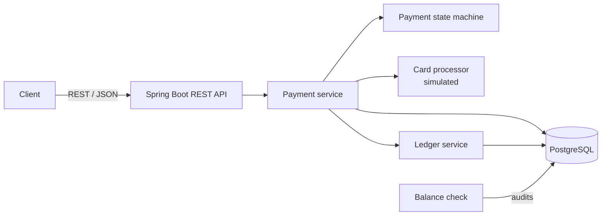

# Payments & Ledger Service

[](https://github.com/cabasoah/Payments-and-ledger-service-Java-/actions/workflows/ci.yml)

A backend service that lets merchants **take card payments, capture them, and issue refunds**, while keeping a **double-entry accounting ledger** that is guaranteed to balance.

It is built the way real payment systems are built: money is never stored as floating point, the books can't be edited after the fact, concurrent refunds can't overspend, and an automated audit proves the numbers add up.

**Java 21 · Spring Boot 4 · PostgreSQL 16 · REST + OpenAPI · Docker · Testcontainers · GitHub Actions**

---

## What it does

- **Merchants** register and accept payments in any standard currency (CAD, USD, JPY, …).
- **Payments** are authorized against a (simulated) card processor, then **captured** to actually collect the money.
- **Refunds** can be partial or full, and can never add up to more than was captured.
- **Every money movement** is written to an accounting ledger as balanced debits and credits.
- **Clear errors**: every failure returns a standard, machine-readable error (for example `REFUND_EXCEEDS_CAPTURED`).
- **Interactive API docs** (Swagger UI) let anyone try the API in a browser.

## Engineering highlights

| Problem | How this project solves it |
|---|---|
| **Rounding errors with money** | Amounts are whole numbers of cents with a currency (`Money` type). It never uses floating point, and a test checks its fields and methods to make sure. Mixing currencies throws an error. |
| **Two refunds at the same moment overspending a payment** | Capture and refund lock the payment's database row, so requests for the same payment run one at a time. A test fires 10 refunds at once and checks that exactly the right number succeed. The test fails if the lock is removed. |
| **Payments jumping into invalid states** (e.g. refunding before capturing) | A single state machine defines every allowed status change. A test checks every one of the 36 possible from/to combinations. |
| **Accounting records being changed after the fact** | The ledger is append-only. Database triggers reject any edit or delete, so mistakes are corrected with new reversing entries, as in real bookkeeping. |
| **Silent data corruption** | An automated balance check uses SQL to prove that total debits equal total credits, and that each merchant's balance matches their payments. A test deliberately corrupts a record and confirms the check catches it. |
| **Bad data reaching the database** | The database itself enforces the money rules (e.g. refunded ≤ captured ≤ amount, status must match amounts), as a second line of defence behind the application code. |
| **A client retrying after a timeout and charging the customer twice** | Every money-moving request needs an `Idempotency-Key`. A retry with the same key replays the original response instead of acting again; the key is saved in the same database transaction as the payment. A test fires 20 identical requests at once and checks that exactly one payment and one set of ledger entries are created. |
| **Unclear API errors** | Every error follows the RFC 7807 standard (`application/problem+json`) with a stable error code. |

### How it was built

- **Test-driven:** tests for anything involving money or concurrency were written and reviewed *before* the implementation.
- **Tested against a real database:** integration tests run against PostgreSQL in Docker (Testcontainers), not mocks. After every API test, the full ledger audit runs automatically.
- **Continuous integration:** GitHub Actions runs formatting checks and the full test suite on every push and pull request.
- **Documented decisions:** each significant design choice is recorded with its alternatives and trade-offs in [docs/DECISIONS.md](docs/DECISIONS.md).

## Architecture



Each operation (create, capture, refund) runs in **one database transaction**: the payment, the refund record and the ledger entries are saved together or not at all.

## Quick start

You need **Docker** and **JDK 21**.

```bash
docker compose up -d --wait                                # start PostgreSQL (and RabbitMQ)
./mvnw spring-boot:run -Dspring-boot.run.profiles=local    # start the service
```

Then open **http://localhost:8080/swagger-ui.html** to explore and call the API from your browser.

<details>
<summary>Or try it from the command line</summary>

```bash
# POSTs that move money need an Idempotency-Key: any unique string (a UUID is typical).
# Re-sending the same request with the same key replays the first response instead of charging twice.
MERCHANT=$(curl -s -X POST localhost:8080/v1/merchants \
  -H 'Content-Type: application/json' -d '{"name":"Acme Coffee"}' | jq -r .id)

PAYMENT=$(curl -s -X POST localhost:8080/v1/payments -H 'Content-Type: application/json' \
  -H "Idempotency-Key: $(date +%s%N)" \
  -d "{\"merchantId\":\"$MERCHANT\",\"amount\":1050,\"currency\":\"CAD\",\"cardToken\":\"tok_visa_ok\"}" | jq -r .id)

curl -s -X POST localhost:8080/v1/payments/$PAYMENT/capture \
  -H "Idempotency-Key: $(date +%s%N)"                                               # collect $10.50
curl -s -X POST localhost:8080/v1/payments/$PAYMENT/refunds \
  -H 'Content-Type: application/json' -H "Idempotency-Key: $(date +%s%N)" \
  -d '{"amount":300}'                                                            # refund $3.00
curl -s localhost:8080/v1/payments/$PAYMENT                                      # PARTIALLY_REFUNDED
```

</details>

Run the tests (Docker required for the integration tests):

```bash
./mvnw verify
```

## Deploy to AWS

A minimal, low-cost deployment is defined in Terraform ([infra/terraform](infra/terraform)). It runs one container on **ECS Fargate** and a private **RDS PostgreSQL** database in `ca-central-1`, with the database password in **Secrets Manager** and a monthly **budget alert**.

You need Terraform, the AWS CLI and Docker. **[docs/DEPLOY.md](docs/DEPLOY.md)** walks through every step, from creating an AWS account to teardown.

```bash
cp infra/terraform/terraform.tfvars.example infra/terraform/terraform.tfvars   # set alert_email
./scripts/deploy.sh      # build, push and deploy; prints the app URL
./scripts/app-url.sh     # print the URL again (it changes on every deploy)
./scripts/teardown.sh    # delete everything, including the database
```

> **Cost:** about **$40/month** if left running (estimate from AWS on-demand prices), so tear it down when you're not using it.
> This setup is deliberately minimal and **not production-ready** (no HTTPS, no authentication, single instance). See the [full list of gaps](docs/DECISIONS.md#2026-11-17-what-the-minimal-aws-setup-is-not-ready-for), which a later phase addresses.

## Use it from an AI assistant (MCP)

[MCP (Model Context Protocol)](https://modelcontextprotocol.io) is an open standard that lets an AI assistant such as Claude Desktop call an application's tools. Here it lets the assistant look up payments, move money and check the ledger through the same service code as the REST API, so validation, idempotency, row locking and the ledger balance rules all still apply.

| Tool | Kind | What it does |
|---|---|---|
| `get_payment` | read | Status, amount, captured, refunded and refundable amounts, refunds |
| `list_payments` | read | A merchant's recent payments, newest first (`limit` 1–100, default 20) |
| `get_ledger_balance` | read | A payment's ledger entries, debit/credit totals per currency, `balanced`, and `matchesPayment` (merchant payable = captured − refunded) |
| `create_payment` | **write** | Create and authorize a payment. Needs `idempotencyKey` |
| `capture_payment` | **write** | Capture an authorized payment. Needs `idempotencyKey` |
| `refund_payment` | **write** | Refund part or all of a captured payment. Needs `idempotencyKey` |

- **Read-only by default.** The write tools are only offered when `MCP_READ_ONLY=false`, and their descriptions start with `WRITE ACTION: moves money.`
- **Money is never ambiguous.** Inputs are integer minor units with a currency; every amount returned looks like `{"amount": 1050, "currency": "CAD", "display": "10.50 CAD"}`.
- **Safe retries.** A retried write with the same `idempotencyKey` returns the original result (`"replayed": true`) instead of acting twice. A key works the same through REST and MCP.
- **Clear errors.** Failures return the REST error code with the backend's message and a hint, e.g. `REFUND_EXCEEDS_CAPTURED`: "Refund of 8.00 CAD exceeds the remaining refundable 7.50 CAD".
- **Audit log.** Every tool call is logged with its arguments, outcome and result to stderr and to `MCP_AUDIT_LOG` (default `logs/mcp-audit.log`).

### Run it

The MCP server is the same jar started with the `mcp` profile. The assistant launches it and talks to it over stdin/stdout.

```bash
docker compose up -d --wait postgres     # the database
./mvnw -DskipTests package               # builds target/payments-ledger-0.0.1-SNAPSHOT.jar
```

There is no merchant tool, so create a merchant through the REST API first and note its `id` (run `./mvnw spring-boot:run -Dspring-boot.run.profiles=local` in another terminal, then):

```bash
curl -s -X POST localhost:8080/v1/merchants -H 'Content-Type: application/json' -d '{"name":"Acme Coffee"}'
```

### Connect Claude Desktop

Claude Desktop reads MCP servers from `claude_desktop_config.json`:

| OS | Config file |
|---|---|
| Windows | `%APPDATA%\Claude\claude_desktop_config.json` |
| macOS | `~/Library/Application Support/Claude/claude_desktop_config.json` |

1. **Quit Claude Desktop completely** (on Windows, also from the system tray icon). It saves its own settings to this file and can overwrite edits made while it is running.
2. Open the file in an editor. It may already contain the app's own keys (such as `"preferences"`): keep them, and add `"mcpServers"` alongside them as another top-level key. If the file doesn't exist, create it.
3. Add the server, replacing both paths with the absolute path to your clone:

```json
{
  "mcpServers": {
    "payments-ledger": {
      "command": "java",
      "args": [
        "-jar",
        "C:\\path\\to\\payments-ledger\\target\\payments-ledger-0.0.1-SNAPSHOT.jar",
        "--spring.profiles.active=mcp"
      ],
      "env": {
        "DB_URL": "jdbc:postgresql://localhost:5433/payments",
        "DB_USER": "payments",
        "DB_PASSWORD": "payments",
        "MCP_READ_ONLY": "false",
        "MCP_AUDIT_LOG": "C:\\path\\to\\payments-ledger\\logs\\mcp-audit.log"
      }
    }
  }
}
```

4. Start Claude Desktop. The payments tools appear in the chat's tools list.

Leave out `MCP_READ_ONLY` (or set it to `"true"`) to offer only the read tools.

If the tools don't appear, check Claude Desktop's logs (Windows `%APPDATA%\Claude\logs`, macOS `~/Library/Logs/Claude`): `mcp.log`, and `mcp-server-payments-ledger.log` once it has tried to start the server. Common causes: `java` isn't on the PATH Claude Desktop sees (put the full path to the JDK 21 `java` executable in `command`), Postgres isn't running, or the jar hasn't been built.

### Example: refund part of a payment, then check the ledger

A real Claude Desktop session against a local database (2026-11-23), with writes enabled. Tool results are shortened to the fields that matter; the tool calls match the server's audit log.

**You:** Create a 25.00 CAD payment for merchant `0bf138b8-8c38-4d1d-9256-bfe2e5e64eb5` with card `tok_visa_ok`, then capture it.

> `create_payment` `{merchantId: 0bf138b8-…, amount: 2500, currency: CAD, cardToken: tok_visa_ok, idempotencyKey: create-0bf138b8-2500CAD-20261123-a7f3c9e1}`
> → `id: 0073eb64-c506-45b5-98b2-d8fcf69f363e`, `status: AUTHORIZED`, `amount: 25.00 CAD`, `replayed: false`
>
> `capture_payment` `{paymentId: 0073eb64-…, idempotencyKey: capture-0073eb64-20261123-b2d8e4f6}`
> → `status: CAPTURED`, `captured: 25.00 CAD`, `refundable: 25.00 CAD`

**Claude:** I created the 25.00 CAD payment and captured it. Payment ID: 0073eb64-c506-45b5-98b2-d8fcf69f363e. Status: CAPTURED, so the full 25.00 CAD has been collected and recorded in the ledger. Refundable: 25.00 CAD.

**You:** Refund 7.50 CAD of that payment.

> `refund_payment` `{paymentId: 0073eb64-…, amount: 750, idempotencyKey: refund-0073eb64-750CAD-20261123-c4e9a1d2}`
> → refund `2ccd70f9-8a0e-4bb5-8bb3-10720e687aeb` of `7.50 CAD`; payment `status: PARTIALLY_REFUNDED`, `refunded: 7.50 CAD`, `refundable: 17.50 CAD`

**Claude:** I refunded 7.50 CAD. Payment status: PARTIALLY_REFUNDED (25.00 CAD captured, 7.50 CAD refunded). Still refundable: 17.50 CAD.

**You:** Now try refunding 20.00 more.

*(no tool call)*

**Claude:** I didn't send that refund because only 17.50 CAD is left to refund on this payment. It captured 25.00 CAD and 7.50 CAD has already gone back, so a 20.00 CAD refund would be rejected and nothing would change. Do you want me to refund the remaining 17.50 CAD instead?

**You:** Check that the ledger for that payment balances.

> `get_payment` `{paymentId: 0073eb64-…}` → `status: PARTIALLY_REFUNDED`, `refundable: 17.50 CAD`
>
> `get_ledger_balance` `{paymentId: 0073eb64-…}` → `balanced: true`, `matchesPayment: true`, `merchantPayableBalance: 17.50 CAD`, `expectedMerchantPayableBalance: 17.50 CAD`, totals CAD debits `32.50` / credits `32.50`, 4 entries

**Claude:** The ledger for this payment balances, and it matches the payment record.

| Journal | Account | Debit | Credit |
|---|---|---|---|
| CAPTURE | PROCESSOR_RECEIVABLE | 25.00 | |
| CAPTURE | MERCHANT_PAYABLE | | 25.00 |
| REFUND | MERCHANT_PAYABLE | 7.50 | |
| REFUND | PROCESSOR_RECEIVABLE | | 7.50 |
| **Total (CAD)** | | **32.50** | **32.50** |

Merchant payable: 17.50 CAD, which is the 25.00 CAD captured minus the 7.50 CAD refunded. There are no entries for the 20.00 CAD refund because I didn't send it.

In this run Claude declined the over-refund itself, using the `refundable` amount from the earlier result, so the server never saw it. Had it sent the call, the backend would have rejected it with `REFUND_EXCEEDS_CAPTURED` and changed nothing; `McpToolsIT.overRefundIsRejectedAndChangesNothing` tests exactly that.

## Roadmap

- [x] Money type, payment state machine, database constraints
- [x] Double-entry ledger with append-only enforcement and automated balance audit
- [x] REST API: merchants, payments, capture, refunds, standard error format, OpenAPI docs
- [x] Docker image and minimal AWS deployment (Terraform: ECS Fargate, RDS, Secrets Manager)
- [ ] API key authentication per merchant
- [x] Idempotency keys (safe retries), including under concurrent duplicates
- [x] MCP server so an AI assistant can read payments, move money and check the ledger
- [ ] Transactional outbox and RabbitMQ events
- [ ] Signed webhooks with retries and a dead-letter queue
- [ ] Load testing (k6), metrics and tracing (OpenTelemetry, Prometheus, Grafana)
- [ ] Production-grade AWS: HTTPS load balancer, private subnets, remote Terraform state, CI/CD deploys

---

## Technical reference

<details>
<summary><b>API endpoints</b></summary>

Amounts are **integer minor units** plus an ISO 4217 currency code: `"amount": 1050, "currency": "CAD"` is 10.50 CAD. JPY has no decimals, so `1050 JPY` is ¥1050. There's no authentication yet: the merchant is given as `merchantId` in the request body, and API keys will replace it without changing any URL.

| Method | Path | Body | Success |
|---|---|---|---|
| `POST` | `/v1/merchants` | `{name}` | `201` merchant |
| `POST` | `/v1/payments` | `{merchantId, amount, currency, cardToken}` | `201` payment (`AUTHORIZED` or `FAILED`) |
| `POST` | `/v1/payments/{id}/capture` | none | `200` payment (full capture) |
| `POST` | `/v1/payments/{id}/refunds` | `{amount}` | `201` refund (partial or full) |
| `GET` | `/v1/payments/{id}` | none | `200` payment, including its refunds |

Card tokens are simulated; real card numbers are never accepted.

| Token | Result |
|---|---|
| `tok_visa_ok` | Authorized |
| `tok_declined` | Declined: stored as a `FAILED` payment (still `201`) |
| anything else | `422 INVALID_CARD_TOKEN` |

</details>

<details>
<summary><b>Payment lifecycle</b></summary>

| From | Allowed next |
|---|---|
| `PENDING` | `AUTHORIZED`, `FAILED` |
| `AUTHORIZED` | `CAPTURED`, `FAILED` |
| `CAPTURED` | `PARTIALLY_REFUNDED`, `REFUNDED` |
| `PARTIALLY_REFUNDED` | `PARTIALLY_REFUNDED` (another partial refund), `REFUNDED` |
| `REFUNDED`, `FAILED` | none (terminal) |

`PaymentStatus` holds this table and is the only place allowed moves are defined. The database also checks that each status matches its amounts (for example, a `CAPTURED` payment can't have refunds recorded).

</details>

<details>
<summary><b>Error format</b></summary>

```json
{
  "type": "/problems/refund-exceeds-captured",
  "title": "Refund exceeds captured amount",
  "status": 422,
  "detail": "Refund of 8.00 CAD exceeds the remaining refundable 7.50 CAD",
  "instance": "/v1/payments/df106970-7336-4c52-af14-c47c3865d3f5/refunds",
  "code": "REFUND_EXCEEDS_CAPTURED"
}
```

| Code | Status | When |
|---|---|---|
| `VALIDATION_FAILED` | 400 | Invalid field (includes an `errors` list), unknown currency, malformed id |
| `MALFORMED_REQUEST` | 400 | Body is missing or not valid JSON |
| `MERCHANT_NOT_FOUND` | 404 | Unknown `merchantId` |
| `PAYMENT_NOT_FOUND` | 404 | Unknown payment id |
| `INVALID_STATE_TRANSITION` | 409 | e.g. capture twice, refund before capture |
| `INVALID_CARD_TOKEN` | 422 | Token isn't `tok_visa_ok` or `tok_declined` |
| `REFUND_EXCEEDS_CAPTURED` | 422 | Refund total would exceed the captured amount |
| `IDEMPOTENCY_KEY_MISSING` | 400 | `Idempotency-Key` header missing or blank on a POST that moves money |
| `IDEMPOTENCY_KEY_REUSED` | 422 | The key was already used for a different request |
| `IDEMPOTENCY_REQUEST_IN_PROGRESS` | 409 | A request with the same key is still running; retry shortly |
| `INTERNAL_ERROR` | 500 | Unexpected error (details are logged, not returned) |

</details>

<details>
<summary><b>Ledger design</b></summary>

One `MERCHANT_PAYABLE` account per merchant per currency (what we owe the merchant), and one platform `PROCESSOR_RECEIVABLE` account per currency (what the card processor owes us).

| Event | Debit | Credit |
|---|---|---|
| Authorize | (nothing: no money moves yet) | |
| Capture | `PROCESSOR_RECEIVABLE` | `MERCHANT_PAYABLE` (merchant) |
| Refund | `MERCHANT_PAYABLE` (merchant) | `PROCESSOR_RECEIVABLE` |

- **Balanced:** `LedgerService` rejects any journal whose debits and credits differ in any currency.
- **Append-only:** PostgreSQL triggers reject `UPDATE`, `DELETE` and `TRUNCATE` on the ledger tables.
- **Audited:** `BalanceCheck` proves debits = credits per currency, and that each merchant's balance = captured − refunded.

</details>

<details>
<summary><b>Testing</b></summary>

```bash
./mvnw verify -DskipITs   # build + unit tests (no Docker needed)
./mvnw verify             # + integration tests (Testcontainers)
./mvnw spotless:check     # formatting (google-java-format)
```

- **Unit tests** (`*Test`): `Money`, the full status transition matrix, the `Payment` rules, `LedgerService`, and each MCP tool's input validation, output shape, error mapping and audit log line.
- **Integration tests** (`*IT`), against real PostgreSQL in Docker:
  - `AbstractIT`: database constraints, ledger triggers, the balance check. Each test is rolled back.
  - `AbstractApiIT`: HTTP tests against the running service, on their own database. These cover the happy path, every error code, request validation, and concurrent refunds and captures. The ledger audit must pass after every test.
  - MCP tools (`McpToolsIT`, `McpReadOnlyIT`, `McpStdioIT`): a retried or concurrent `create_payment` with one key creates one payment, an over-refund is rejected and changes nothing, the ledger balances after create, capture and refund, read-only mode offers only the read tools, and real JSON-RPC over the stdio transport.

</details>

<details>
<summary><b>Local configuration and database</b></summary>

| What | Where |
|---|---|
| Swagger UI | http://localhost:8080/swagger-ui.html |
| OpenAPI spec | http://localhost:8080/v3/api-docs |
| Health | http://localhost:8080/actuator/health |
| RabbitMQ management | http://localhost:15672 (payments / payments) |

| Variable | Default |
|---|---|
| `DB_URL` | `jdbc:postgresql://localhost:5433/payments` |
| `DB_USER` | `payments` |
| `DB_PASSWORD` | `payments` |

PostgreSQL is published on port **5433** to avoid clashing with a locally installed one. Flyway migrations in `src/main/resources/db/migration` run on startup; Hibernate only validates the schema, and never changes it.

| Migration | Creates |
|---|---|
| `V1__init.sql` | Nothing (baseline) |
| `V2__create_merchants_and_payments.sql` | `merchants`, `payments`, with CHECKs for the amount rules and status/amount consistency |
| `V3__create_ledger.sql` | `ledger_accounts`, `journal_transactions`, `ledger_entries`, append-only triggers |
| `V4__create_refunds.sql` | `refunds` |

</details>

<details>
<summary><b>Project structure</b></summary>

```
src/main/java/com/adomako/payments/
  common/      Money type, error handling, OpenAPI config
  merchant/    merchants API
  payment/     payment aggregate, state machine, API, refunds
  ledger/      accounts, journals, balance check
  processor/   simulated card processor
  mcp/         MCP server and tools for AI assistants
src/main/resources/db/migration/   Flyway SQL migrations
infra/terraform/                   AWS infrastructure (ECS Fargate, RDS, ECR)
scripts/                           deploy, app-url and teardown scripts
Dockerfile                         multi-stage build, non-root runtime image
docs/DECISIONS.md                  design decisions and trade-offs
```

</details>
