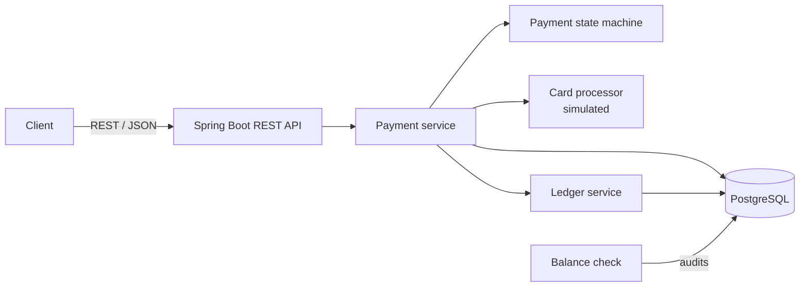

# Payments & Ledger Service

[](https://github.com/cabasoah/Payments-and-ledger-service-Java-/actions/workflows/ci.yml)

A backend service that lets merchants **take card payments, capture them, and issue refunds**, while keeping a **double-entry accounting ledger** that is guaranteed to balance.

It is built the way real payment systems are built: money is never stored as floating point, the books can't be edited after the fact, concurrent refunds can't overspend, and an automated audit proves the numbers add up.

**Java 21 · Spring Boot 4 · PostgreSQL 16 · REST + OpenAPI · Docker · Testcontainers · GitHub Actions**

---

## What it does

- **Merchants** register and accept payments in any standard currency (CAD, USD, JPY, …).
- **Payments** are authorized against a (simulated) card processor, then **captured** to actually collect the money.
- **Refunds** can be partial or full, and can never add up to more than was captured.
- **Every money movement** is written to an accounting ledger as balanced debits and credits.
- **Clear errors**: every failure returns a standard, machine-readable error (for example `REFUND_EXCEEDS_CAPTURED`).
- **Interactive API docs** (Swagger UI) let anyone try the API in a browser.

## Engineering highlights

| Problem | How this project solves it |
|---|---|
| **Rounding errors with money** | Amounts are whole numbers of cents with a currency (`Money` type). It never uses floating point, and a test checks its fields and methods to make sure. Mixing currencies throws an error. |
| **Two refunds at the same moment overspending a payment** | Capture and refund lock the payment's database row, so requests for the same payment run one at a time. A test fires 10 refunds at once and checks that exactly the right number succeed. The test fails if the lock is removed. |
| **Payments jumping into invalid states** (e.g. refunding before capturing) | A single state machine defines every allowed status change. A test checks every one of the 36 possible from/to combinations. |
| **Accounting records being changed after the fact** | The ledger is append-only. Database triggers reject any edit or delete, so mistakes are corrected with new reversing entries, as in real bookkeeping. |
| **Silent data corruption** | An automated balance check uses SQL to prove that total debits equal total credits, and that each merchant's balance matches their payments. A test deliberately corrupts a record and confirms the check catches it. |
| **Bad data reaching the database** | The database itself enforces the money rules (e.g. refunded ≤ captured ≤ amount, status must match amounts), as a second line of defence behind the application code. |
| **Unclear API errors** | Every error follows the RFC 7807 standard (`application/problem+json`) with a stable error code. |

### How it was built

- **Test-driven:** tests for anything involving money or concurrency were written and reviewed *before* the implementation.
- **Tested against a real database:** integration tests run against PostgreSQL in Docker (Testcontainers), not mocks. After every API test, the full ledger audit runs automatically.
- **Continuous integration:** GitHub Actions runs formatting checks and the full test suite on every push and pull request.
- **Documented decisions:** each significant design choice is recorded with its alternatives and trade-offs in [docs/DECISIONS.md](docs/DECISIONS.md).

## Architecture



Each operation (create, capture, refund) runs in **one database transaction**: the payment, the refund record and the ledger entries are saved together or not at all.

## Quick start

You need **Docker** and **JDK 21**.

```bash
docker compose up -d --wait                                # start PostgreSQL (and RabbitMQ)
./mvnw spring-boot:run -Dspring-boot.run.profiles=local    # start the service
```

Then open **http://localhost:8080/swagger-ui.html** to explore and call the API from your browser.

<details>
<summary>Or try it from the command line</summary>

```bash
MERCHANT=$(curl -s -X POST localhost:8080/v1/merchants \
  -H 'Content-Type: application/json' -d '{"name":"Acme Coffee"}' | jq -r .id)

PAYMENT=$(curl -s -X POST localhost:8080/v1/payments -H 'Content-Type: application/json' \
  -d "{\"merchantId\":\"$MERCHANT\",\"amount\":1050,\"currency\":\"CAD\",\"cardToken\":\"tok_visa_ok\"}" | jq -r .id)

curl -s -X POST localhost:8080/v1/payments/$PAYMENT/capture                      # collect $10.50
curl -s -X POST localhost:8080/v1/payments/$PAYMENT/refunds \
  -H 'Content-Type: application/json' -d '{"amount":300}'                       # refund $3.00
curl -s localhost:8080/v1/payments/$PAYMENT                                      # PARTIALLY_REFUNDED
```

</details>

Run the tests (Docker required for the integration tests):

```bash
./mvnw verify
```

## Roadmap

- [x] Money type, payment state machine, database constraints
- [x] Double-entry ledger with append-only enforcement and automated balance audit
- [x] REST API: merchants, payments, capture, refunds, standard error format, OpenAPI docs
- [ ] API key authentication per merchant
- [ ] Idempotency keys (safe retries)
- [ ] Transactional outbox and RabbitMQ events
- [ ] Signed webhooks with retries and a dead-letter queue
- [ ] Load testing (k6), metrics and tracing (OpenTelemetry, Prometheus, Grafana)
- [ ] Cloud deployment (Terraform, AWS ECS Fargate, RDS)

---

## Technical reference

<details>
<summary><b>API endpoints</b></summary>

Amounts are **integer minor units** plus an ISO 4217 currency code: `"amount": 1050, "currency": "CAD"` is 10.50 CAD. JPY has no decimals, so `1050 JPY` is ¥1050. There's no authentication yet: the merchant is given as `merchantId` in the request body, and API keys will replace it without changing any URL.

| Method | Path | Body | Success |
|---|---|---|---|
| `POST` | `/v1/merchants` | `{name}` | `201` merchant |
| `POST` | `/v1/payments` | `{merchantId, amount, currency, cardToken}` | `201` payment (`AUTHORIZED` or `FAILED`) |
| `POST` | `/v1/payments/{id}/capture` | none | `200` payment (full capture) |
| `POST` | `/v1/payments/{id}/refunds` | `{amount}` | `201` refund (partial or full) |
| `GET` | `/v1/payments/{id}` | none | `200` payment, including its refunds |

Card tokens are simulated; real card numbers are never accepted.

| Token | Result |
|---|---|
| `tok_visa_ok` | Authorized |
| `tok_declined` | Declined: stored as a `FAILED` payment (still `201`) |
| anything else | `422 INVALID_CARD_TOKEN` |

</details>

<details>
<summary><b>Payment lifecycle</b></summary>

| From | Allowed next |
|---|---|
| `PENDING` | `AUTHORIZED`, `FAILED` |
| `AUTHORIZED` | `CAPTURED`, `FAILED` |
| `CAPTURED` | `PARTIALLY_REFUNDED`, `REFUNDED` |
| `PARTIALLY_REFUNDED` | `PARTIALLY_REFUNDED` (another partial refund), `REFUNDED` |
| `REFUNDED`, `FAILED` | none (terminal) |

`PaymentStatus` holds this table and is the only place allowed moves are defined. The database also checks that each status matches its amounts (for example, a `CAPTURED` payment can't have refunds recorded).

</details>

<details>
<summary><b>Error format</b></summary>

```json
{
  "type": "/problems/refund-exceeds-captured",
  "title": "Refund exceeds captured amount",
  "status": 422,
  "detail": "Refund of 8.00 CAD exceeds the remaining refundable 7.50 CAD",
  "instance": "/v1/payments/df106970-7336-4c52-af14-c47c3865d3f5/refunds",
  "code": "REFUND_EXCEEDS_CAPTURED"
}
```

| Code | Status | When |
|---|---|---|
| `VALIDATION_FAILED` | 400 | Invalid field (includes an `errors` list), unknown currency, malformed id |
| `MALFORMED_REQUEST` | 400 | Body is missing or not valid JSON |
| `MERCHANT_NOT_FOUND` | 404 | Unknown `merchantId` |
| `PAYMENT_NOT_FOUND` | 404 | Unknown payment id |
| `INVALID_STATE_TRANSITION` | 409 | e.g. capture twice, refund before capture |
| `INVALID_CARD_TOKEN` | 422 | Token isn't `tok_visa_ok` or `tok_declined` |
| `REFUND_EXCEEDS_CAPTURED` | 422 | Refund total would exceed the captured amount |
| `INTERNAL_ERROR` | 500 | Unexpected error (details are logged, not returned) |

</details>

<details>
<summary><b>Ledger design</b></summary>

One `MERCHANT_PAYABLE` account per merchant per currency (what we owe the merchant), and one platform `PROCESSOR_RECEIVABLE` account per currency (what the card processor owes us).

| Event | Debit | Credit |
|---|---|---|
| Authorize | (nothing: no money moves yet) | |
| Capture | `PROCESSOR_RECEIVABLE` | `MERCHANT_PAYABLE` (merchant) |
| Refund | `MERCHANT_PAYABLE` (merchant) | `PROCESSOR_RECEIVABLE` |

- **Balanced:** `LedgerService` rejects any journal whose debits and credits differ in any currency.
- **Append-only:** PostgreSQL triggers reject `UPDATE`, `DELETE` and `TRUNCATE` on the ledger tables.
- **Audited:** `BalanceCheck` proves debits = credits per currency, and that each merchant's balance = captured − refunded.

</details>

<details>
<summary><b>Testing</b></summary>

```bash
./mvnw verify -DskipITs   # build + unit tests (no Docker needed)
./mvnw verify             # + integration tests (Testcontainers)
./mvnw spotless:check     # formatting (google-java-format)
```

- **Unit tests** (`*Test`): `Money`, the full status transition matrix, the `Payment` rules, and `LedgerService`.
- **Integration tests** (`*IT`), against real PostgreSQL in Docker:
  - `AbstractIT`: database constraints, ledger triggers, the balance check. Each test is rolled back.
  - `AbstractApiIT`: HTTP tests against the running service, on their own database. These cover the happy path, every error code, request validation, and concurrent refunds and captures. The ledger audit must pass after every test.

</details>

<details>
<summary><b>Local configuration and database</b></summary>

| What | Where |
|---|---|
| Swagger UI | http://localhost:8080/swagger-ui.html |
| OpenAPI spec | http://localhost:8080/v3/api-docs |
| Health | http://localhost:8080/actuator/health |
| RabbitMQ management | http://localhost:15672 (payments / payments) |

| Variable | Default |
|---|---|
| `DB_URL` | `jdbc:postgresql://localhost:5433/payments` |
| `DB_USER` | `payments` |
| `DB_PASSWORD` | `payments` |

PostgreSQL is published on port **5433** to avoid clashing with a locally installed one. Flyway migrations in `src/main/resources/db/migration` run on startup; Hibernate only validates the schema, and never changes it.

| Migration | Creates |
|---|---|
| `V1__init.sql` | Nothing (baseline) |
| `V2__create_merchants_and_payments.sql` | `merchants`, `payments`, with CHECKs for the amount rules and status/amount consistency |
| `V3__create_ledger.sql` | `ledger_accounts`, `journal_transactions`, `ledger_entries`, append-only triggers |
| `V4__create_refunds.sql` | `refunds` |

</details>

<details>
<summary><b>Project structure</b></summary>

```
src/main/java/com/adomako/payments/
  common/      Money type, error handling, OpenAPI config
  merchant/    merchants API
  payment/     payment aggregate, state machine, API, refunds
  ledger/      accounts, journals, balance check
  processor/   simulated card processor
src/main/resources/db/migration/   Flyway SQL migrations
docs/DECISIONS.md                  design decisions and trade-offs
```

</details>
